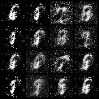

# Devoir Projet 2 : Modeles Generatifs avec PyTorch

Ce projet explore les architectures generatives profondes appliquees au jeu de donnees manuscrit MNIST.

---

## Contenu du Dossier

- **Modeles_generatifs_pytorch.ipynb** : Notebook pratique implementant les differents modeles generatifs.
- **Modeles_generatifs_pytorch_avec_explications.ipynb** : Notebook detaille incluant les explications theoriques bloc par bloc.
- **images_generees/** : Echantillons et grilles de chiffres generes automatiquement par le GAN.
- **pyproject.toml** : Configuration officielle de l'environnement Python 3.11 avec UV.
- **.gitignore** : Configuration ignorant les telechargements du dataset et l'environnement virtuel.

---

## Description des Sections

### 1. Modele Discriminatif (Baseline)
- Classifieur de reference apprenant la distribution conditionnelle P(y | x) pour reconnaitre le chiffre.

### 2. Auto-Encodeur Deterministe (AE)
- Compresse l'image d'entree dans un espace latent 2D avant de la reconstruire avec une perte MSE.
- Visualise la repartition des chiffres sur un plan 2D, tout en montrant les limites des zones vides.

### 3. Auto-Encodeur Variationnel (VAE)
- Remplace les points deterministes par une distribution de probabilite normale N(0, I).
- Utilise l'astuce de reparametrisation (z = mu + sigma * epsilon) pour rendre l'echantillonnage derivable.
- Permet la generation continue de nouveaux chiffres par exploration de la variete latente 2D.

### 4. Reseaux Antagonistes Generatifs (GAN)
- Jeu minimax opposant un Generateur produisant des chiffres synthetiques et un Discriminateur les evaluant.

### 5. Modeles de Diffusion (DDPM)
- Processus de bruitage progressif des images suivi de l'apprentissage du debruitage pas a pas.

---

## Apercu des Resultats Generes

Exemple de chiffres synthetiques produits par le Generateur du GAN et exportes dans le dossier `images_generees/` :



---

## Comment Executer

1. Initialiser l'environnement avec UV :
   ```bash
   uv sync
   ```
   Ou via pip :
   ```bash
   pip install torch torchvision matplotlib torcheval
   ```
2. Ouvrir le notebook dans VS Code pour visualiser les reconstructions et generations.
