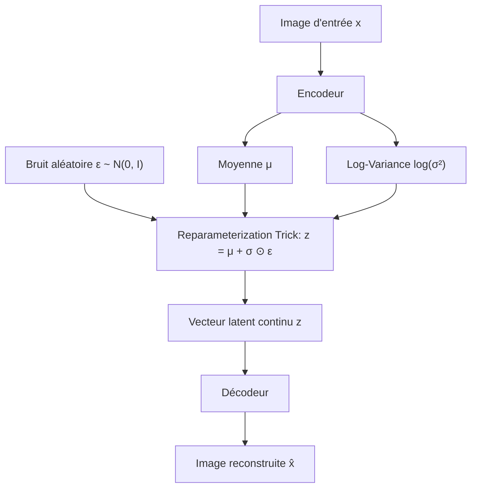

# 🎨 Devoir Projet 2 : Modèles Génératifs avec PyTorch

Bienvenue dans le deuxième devoir pratique dédié à l'exploration fascinante des **modèles génératifs profonds** avec PyTorch ! ✨

Ce projet illustre la transition fondamentale entre l'apprentissage **discriminatif** (prédire $P(y|x)$) et l'apprentissage **génératif** (modéliser et échantillonner la distribution des données $P(x)$) sur le dataset manuscrit MNIST.

---

## 📌 Sommaire
- [🌟 Objectifs & Concepts Clés](#-objectifs--concepts-clés)
- [📂 Structure du Projet](#-structure-du-projet)
- [🛠️ Configuration de l'Environnement avec UV](#️-configuration-de-lenvironnement-avec-uv)
- [🔬 Parcours Architectural](#-parcours-architectural)
  - [1. Modèle Discriminatif (Baseline de Classification)](#1-modèle-discriminatif-baseline-de-classification)
  - [2. Auto-Encodeur Déterministe (AE)](#2-auto-encodeur-déterministe-ae)
  - [3. Auto-Encodeur Variationnel (VAE) 🎲](#3-auto-encodeur-variationnel-vae-)
  - [4. Réseaux Antagonistes Génératifs (GAN) ⚔️](#4-réseaux-antagonistes-génératifs-gan-️)
  - [5. Modèles de Diffusion (DDPM) 🌫️](#5-modèles-de-diffusion-ddpm-️)
- [📊 Tableau Comparatif des Paradigmes](#-tableau-comparatif-des-paradigmes)
- [🚀 Guide d'Exécution Pas à Pas](#-guide-dexécution-pas-à-pas)

---

## 🌟 Objectifs & Concepts Clés
- Comprendre la différence mathématique et pratique entre **modèle discriminatif** et **modèle génératif**.
- Implémenter un **Autoencodeur classique** pour la réduction dimensionnelle non linéaire et la compression.
- Maîtriser l'**Autoencodeur Variationnel (VAE)** :
  - L'espace latent probabiliste régularisé par une distribution normale $\mathcal{N}(0, I)$.
  - L'astuce de reparamétrisation (*Reparameterization Trick*) rendant l'échantillonnage dérivable.
  - La fonction de coût ELBO combinant erreur de reconstruction et divergence de Kullback-Leibler (KL).
- Découvrir la dynamique d'entraînement des **GANs** (jeu minimax entre Générateur et Discriminateur).
- Explorer le fonctionnement moderne des **modèles de diffusion** (bruitage progressif et débruitage inverse).

---

## 📂 Structure du Projet
```bash
devoir projet 2/
├── Modeles_generatifs_pytorch.ipynb                   # Version pratique directe
├── Modeles_generatifs_pytorch_avec_explications.ipynb # Version enrichie de cours détaillée
├── pyproject.toml                                     # Configuration officielle UV (Python 3.11)
└── README.md                                          # Guide complet & démonstrateur
```

---

## 🛠️ Configuration de l'Environnement avec UV
Conformément aux directives de l'activité, le projet est configuré pour être géré avec rapidité et reproductibilité via **UV** sous VS Code :

```powershell
# 1. Initialiser le projet avec Python 3.11
uv init --python=3.11

# 2. Créer l'environnement virtuel
uv venv

# 3. Activer l'environnement
.venv\Scripts\Activate.ps1       # Sous Windows PowerShell
# source .venv/bin/activate       # Sous Linux / macOS

# 4. Installer les dépendances
uv add ipykernel torch torchvision matplotlib torcheval numpy tqdm
```

---

## 🔬 Parcours Architectural

### 1. Modèle Discriminatif (Baseline de Classification)
- **Rôle** : Apprendre la distribution conditionnelle $P(y|x)$ (prédire le chiffre $y \in \{0, \dots, 9\}$ connaissant l'image $x$).
- **Structure** :
  ```
  Image 28x28 ──> [Flatten] ──> [Linear 784 -> 128] ──> [ReLU] ──> [Linear 128 -> 10] ──> Logits
  ```
- **Limitation** : Ce modèle sait reconnaître un chiffre avec brio ($\approx 97\%+$), mais est totalement incapable d'en inventer un nouveau !

---

### 2. Auto-Encodeur Déterministe (AE)
- **Principe** : Compresser l'image dans un goulet d'étranglement (*bottleneck*) de dimension réduite (ex: 2D ou 32D), puis la reconstruire fidèlement.
  ```mermaid
  flowchart LR
      X["Image x (784)"] --> Enc["Encodeur (784 -> 128 -> 2)"]
      Enc --> Z["Espace Latent z (2D)"]
      Z --> Dec["Décodeur (2 -> 128 -> 784)"]
      Dec --> X_hat["Reconstruction x̂ (784)"]
  ```
- **Fonction de coût** : Erreur quadratique moyenne (MSE) entre les pixels réels et reconstruits :
  $$\mathcal{L}_{\text{reconstruction}} = \frac{1}{N} \sum_{i=1}^N (x_i - \hat{x}_i)^2$$
- **Limite majeure observée** : L'espace latent présente des **trous** et des zones de discontinuité. Si l'on choisit un point latent au hasard dans une zone vide, le décodeur génère une image floue ou dénuée de sens.

---

### 3. Auto-Encodeur Variationnel (VAE) 🎲
Le VAE résout l'irrégularité de l'espace latent en remplaçant le point déterministe par une **distribution de probabilité** :
$$\mu, \log \sigma^2 = \text{Encoder}(x)$$



#### Astuce de Reparamétrisation (*Reparameterization Trick*)
Comme l'opération d'échantillonnage stochastique bloque le calcul du gradient, on déporte le caractère aléatoire sur une variable auxiliaire indépendante $\epsilon \sim \mathcal{N}(0, I)$ :
$$z = \mu + \sigma \odot \epsilon \quad \text{avec } \sigma = \exp\left(\frac{1}{2}\log \sigma^2\right)$$
Grâce à cette formulation, la rétropropagation s'effectue directement par rapport aux paramètres $\mu$ et $\sigma$.

#### Fonction de Perte (ELBO)
$$\mathcal{L}_{\text{VAE}} = \mathcal{L}_{\text{reconstruction}}(x, \hat{x}) + \mathcal{D}_{\text{KL}}\big(q(z|x) \,\|\, p(z)\big)$$
- **Terme 1** : Fidélité visuelle de reconstruction.
- **Terme 2 (Divergence KL)** : Force l'espace latent à s'aligner sur une loi Gaussienne centrée réduite $\mathcal{N}(0, I)$, assurant continuité et compacité.

#### Exploration de la variété latente 2D
En faisant varier $z_1, z_2 \in [-2.5, 2.5]$ sur une grille régulière, le décodeur produit une transition fluide et continue entre les différents chiffres (morphing d'un 0 vers un 6, puis un 8 et un 3).

---

### 4. Réseaux Antagonistes Génératifs (GAN) ⚔️
- **Idée maîtresse** : Un duel permanent entre deux réseaux de neurones :
  1. **Le Générateur ($G$)** : Transforme un vecteur de bruit pur $z \sim \mathcal{N}(0, I)$ en une fausse image réaliste.
  2. **Le Discriminateur ($D$)** : Distingue les vraies images du dataset des fausses images produites par $G$.
- **Jeu Minimax** :
  $$\min_G \max_D V(D, G) = \mathbb{E}_{x}[\log D(x)] + \mathbb{E}_{z}[\log(1 - D(G(z)))]$$

---

### 5. Modèles de Diffusion (DDPM) 🌫️
- **Processus avant (Forward)** : Ajout progressif de bruit gaussien selon un échéancier $\beta_1, \dots, \beta_T$ jusqu'à transformer l'image en bruit pur.
- **Processus arrière (Reverse)** : Un réseau de neurones (U-Net) apprend à prédire le bruit ajouté à chaque pas $t$ pour reconstruire progressivement l'image d'origine.

---

## 📊 Tableau Comparatif des Paradigmes

| Modèle | Objectif | Espace Latent | Avantages | Inconvénients |
| :--- | :--- | :--- | :--- | :--- |
| **Discriminatif** | $P(y \mid x)$ | Aucun (sortie de classe) | Simple, précis pour classer | Ne génère rien |
| **Autoencodeur (AE)** | Compression déterministe | Irrégulier, présence de vides | Reconstructions nettes | Échantillonnage aléatoire incohérent |
| **VAE** | $P(x) = \int P(x \mid z)P(z)dz$ | Continu, régulier $\mathcal{N}(0, I)$ | Mathématiquement élégant, interpolation fluide | Reconstructions parfois légèrement lissées |
| **GAN** | Échantillonnage direct | Bruit aléatoire $z$ | Images très nettes et piquées | Entraînement instable (mode collapse) |
| **Diffusion (DDPM)** | Débruitage itératif | Bruit gaussien $T$ pas | Haute qualité visuelle, stabilité maximale | Génération lente (plusieurs pas de débruitage) |

---

## 🚀 Guide d'Exécution Pas à Pas

### Dans VS Code :
1. Sélectionnez le kernel Python de votre environnement `.venv`.
2. Ouvrez **`Modeles_generatifs_pytorch_avec_explications.ipynb`** pour bénéficier des schémas explicatifs détaillés et des commentaires bloc par bloc.
3. Exécutez les cellules séquentiellement :
   - Observez la séparation des classes dans l'espace latent 2D du VAE.
   - Générez la grille de transition de chiffres manuscrits !
